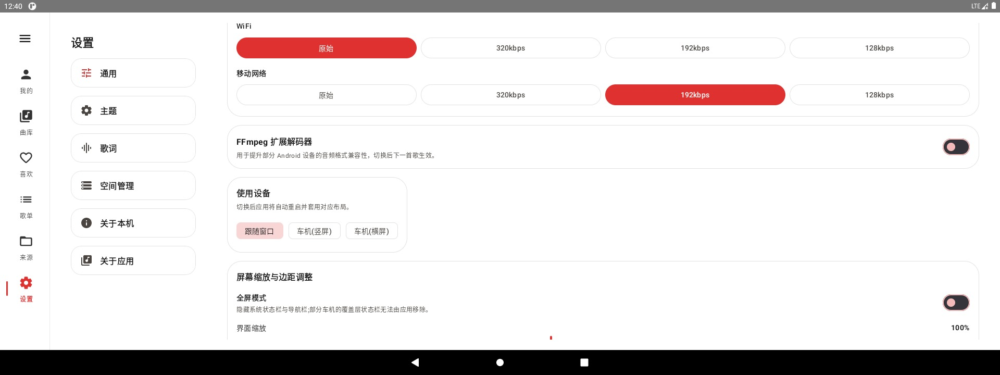
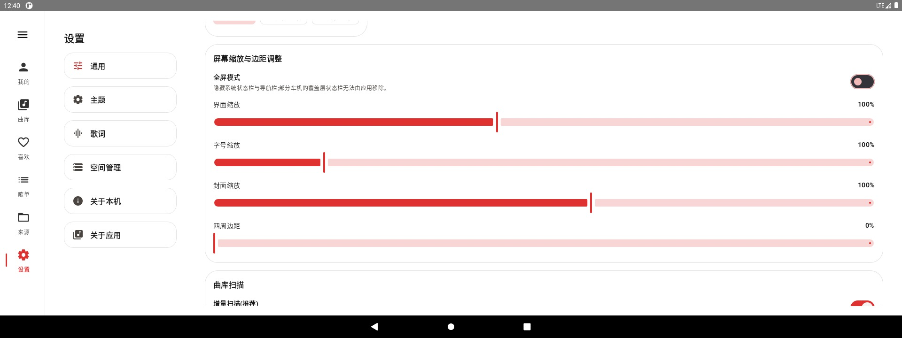
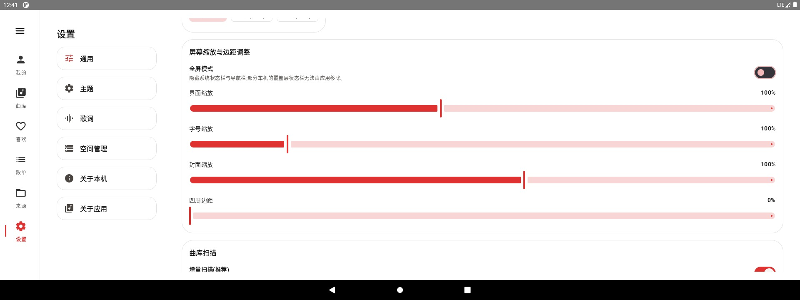

# LynMusic_Car

基于 [LynMusic](https://github.com/wesley666/LynMusic)(GPL-3.0-or-later)复刻的**车机专用**本地音乐播放器。原始跨平台代码与上游特性版权归上游作者;本仓库面向 Android 车机做了裁剪与改造,遵循同一开源协议,发布需继续以 GPL-3.0-or-later 分发。

> 本仓库不与上游同步,独立演进;历史渊源见上游仓库与 LICENSE / THIRD_PARTY_LICENSES。

## 界面预览

以下均为 **Android 模拟器(车机横屏 1920×720)实机截图**(v1.2.0):

| 使用设备 · 全屏开关 | 屏幕缩放与边距调整 |
| :---: | :---: |
|  |  |

**全屏模式**(开启后系统状态栏/导航栏隐藏,回到前台自动重套):



## 定位与适配

- **平台**:Android 车机(通用 Android,非 AAOS 专属),最低 **Android 7.0(minSdk 24)**,分辨率 720P ~ 2.5K
- **架构**:arm64-v8a / armeabi-v7a / x86 / x86_64 四种 APK + universal 通用包,老车机(x86 模拟器、早期 ARM32 方案)也能装
- **体积**:R8 混淆压缩后 arm64 约 **10.5MB**、universal 约 **18MB**,低配车机存储无压力
- **语言**:简体中文 / 繁體中文 / English 三语完整覆盖

## 功能详解

### 🚗 车机双布局预设(「使用设备」)

设置 → 外观模式 → **使用设备**,三选一:

| 选项 | 布局 | 适用 |
| --- | --- | --- |
| 跟随窗口 | 按当前窗口宽高比自动选择竖/横布局 | 不确定就选它 |
| 车机(竖屏) | 大屏手机式底部 Dock 导航,触屏操作 | 竖装中控(特斯拉式大屏) |
| 车机(横屏) | 宽侧栏布局,预留顶部状态栏空间,字号放大 | 横装中控(绝大多数车机) |

切换后**自动重启应用**套用新预设,无需手动杀进程。标签栏高度随内容自适应,不再固定裁切文字。

### 🔍 屏幕缩放与边距调整(老车机救星)

设置 → 外观模式 → 屏幕 → **屏幕缩放与边距调整**,四项独立调节、即时生效:

- **缩放** 70%~140%:整体 UI 密度,小屏调大看得清,大屏调小信息多
- **字号** 80%~200%:只放大文字不动布局,驾驶中扫一眼就能读
- **封面尺寸** 60%~130%:专辑封面在播放页/迷你条的大小
- **四周边距** 上/下/左/右各 0%~30%:车机状态栏压住内容时,把「屏幕上边距」调到 6%~10% 即可避开;右上角「恢复默认」一键还原

### 🖥️ 全屏模式

同页顶部开关。开启后隐藏系统状态栏/导航栏,铺满整个屏幕;**回到前台自动重新套用**(车机系统抢回状态栏也不怕)。对状态栏是系统覆盖层、边距也压不住的车机同样有效。开启后四周边距滑条自动置灰(全屏下无意义)。从屏幕边缘滑动可临时呼出系统栏。

### 💾 U 盘音乐读取(三方案兜底,适配安卓 7~9 老车机)

1. **直读路径**:枚举 `/storage`、`/mnt/media_rw` 等挂载点直接扫描(最快)
2. **SAF**:直读被系统拒绝时走 Storage Access Framework 授权读取
3. **MediaStore**:前两者都拿不到时查系统媒体库兜底

配套能力:

- **插入即扫**:U 盘挂载广播触发,延时 2.5 秒等文件系统就绪后自动重扫对应来源
- **拔出不丢**:拔出后曲目仅标记「不可用」,收藏/歌单引用保留,插回来自动恢复
- **卷身份持久化**:按卷 UUID/文件系统标识识别 U 盘,换了挂载点也不会重复建源
- **播放容错**:播放中 U 盘被拔,给出「USB 存储不可用」明确提示而非崩溃

### 🔄 曲库扫描(增量/全量 + 自动)

设置 → 资料库扫描:

- **增量扫描**(默认开):只处理新增/修改/删除的文件,未变化的曲目一行不动,**收藏与歌单引用零丢失**;嵌入歌词按内容对比,改了就更新
- **全量扫描**:整源重建,适合怀疑数据库脏了的时候
- **启动后自动扫描**(默认开):应用启动 1 分钟后自动扫一遍 U 盘来源,正在扫描时智能跳过
- 扫描记录持久化,重启不重复劳动

### ⏻ 完全退出(「我的」页电源按钮)

「我的」页右上角电源按钮,一键彻底退出:

1. 先暂停播放并**保存播放进度**(2 秒超时兜底,绝不卡死)
2. 关闭播放服务、结束所有进程(服务已设为不自动复活)
3. 下次启动**从上次位置继续播放**

从最近任务划掉应用同样会先落盘进度再退出。

### 🎙️ 语音控制友好(方控/语音助手)

- **「开始播放」**:无播放源或已停止时,自动从持久化进度**续播**上次的歌
- **「停止」**:保存进度 → 暂停 → 光标归零,但**不覆盖已落盘的进度**(下次续播仍从停止前的位置)
- **重复「停止」去重**:1.5 秒内重复指令只执行一次,防止语音助手连发把状态打乱

### 🎛️ 主驾优先布局

横屏播放页:**高频按钮(播放/暂停、上一首、下一首)集中在左侧靠近主驾**,大触控目标(≥56dp),低频功能靠右;竖屏窄屏同样高频靠左,宽屏三段均衡分布。驾驶中盲操命中率更高。

### 🎵 完整本地播放能力(继承上游)

- 本地文件夹导入 + **Samba / WebDAV / Navidrome** 私有网络来源
- 歌词搜索 / 逐字歌词 / 歌词分享 / 标签编辑 / 均衡器
- 格式支持:MP3 / FLAC / APE / WAV / OGG / M4A / DSD 等(ffmpeg 解码)
- 播放队列 / 收藏 / 歌单 / 播放历史 / 随机与循环模式

## 下载安装

到 [Releases](https://github.com/DrSkyFree/LynMusic_Car/releases) 下载对应 APK:

| 文件 | 适用 |
| --- | --- |
| `...-arm64-v8a.apk` | **绝大多数车机首选**(2018 年后的 ARM 方案) |
| `...-armeabi-v7a.apk` | 老 ARM32 车机 |
| `...-x86.apk` / `...-x86_64.apk` | Intel 方案车机 / 模拟器 |
| `...-universal.apk` | 不确定架构就装这个(体积稍大) |

所有 APK 使用**同一持久签名密钥**,版本间可直接覆盖安装,数据不丢。CI 每次发布自动核对签名证书 SHA-256 指纹,不一致直接构建失败。

## 构建

```shell
# Android 车机 debug
.\gradlew.bat :automotiveApp:assembleDebug
# Android 车机 release(4 ABI + universal,R8 混淆压缩)
.\gradlew.bat :automotiveApp:assembleRelease
# 全量测试(本地 Windows 下 androidHostTest 有环境问题,建议在 CI 跑)
.\gradlew.bat fullTest
```

- Gradle Wrapper 9.6.0 / AGP 9.4.1 / Kotlin 2.4.21 / JDK 21
- 产物命名:`LynMusic_Car-<版本>-release-<abi>.apk`,输出在 `automotiveApp/build/outputs/apk/release/`
- 签名:CI 从 GitHub Secrets(`ANDROID_SIGNING_*`)注入;本地构建可用同名环境变量或 `local.properties`

## 发布流程

1. 在 `app-version.xcconfig` 更新 `APP_VERSION_CODE` / `APP_VERSION_NAME`
2. 在 `CHANGELOG.md` 顶部新增 `## <版本号>` 小节写更新日志
3. 打 tag(`v<版本号>`)推送 → Actions 自动:构建 → 签名 → **apksigner 指纹校验** → 创建 Release(附 CHANGELOG 对应小节与全部 APK)

## 申明

1. 本项目**仅供学习与技术研究**,不得用于任何商业用途或非法用途。
2. 作者对使用本项目产生的任何后果**不承担责任**;因使用本软件导致的设备损坏、数据丢失、法律风险等,均由使用者自行承担。
3. 本项目基于 [LynMusic](https://github.com/wesley666/LynMusic) 修改而来,第三方依赖与数据的版权归各自作者所有,详见 [THIRD_PARTY_LICENSES.md](./THIRD_PARTY_LICENSES.md)。
4. 本项目不提供任何音源内容,仅作为本地音乐播放工具;用户需自行确保所播放内容的合法性。

## 许可证

GPL-3.0-or-later。第三方组件见 [THIRD_PARTY_LICENSES.md](./THIRD_PARTY_LICENSES.md)。

## 项目结构

```
LynMusic_Car/
├─ automotiveApp/          # 车机 APK 入口模块(打包产物在这里)
├─ app/runtime/            # 应用运行时装配
├─ android/runtime/        # Android 平台能力实现
├─ ui/common/              # 跨端共用 UI 组件与主题
├─ ui/automotive/          # 车机专用界面(竖/横屏、设置页)
├─ shared/core/            # 核心逻辑与版本常量
├─ shared/resources/       # 多语言文案与资源
├─ shared/data/            # Room 数据库与仓库实现
├─ shared/features/        # 业务功能(播放、扫描、歌词等)
├─ player/core/            # 播放器内核封装
├─ cast/api/               # 外部协议接口(已裁剪为最小集)
├─ buildSrc/               # 自定义 Gradle 构建逻辑
├─ tools/                  # Python 辅助校验脚本
├─ docs/screenshots/       # 界面预览图(Android 模拟器实机截图)
├─ .github/workflows/      # CI:构建、签名、指纹校验、发 Release
└─ app-version.xcconfig    # 版本号唯一来源
```